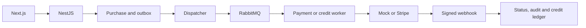

# cine-swipe: Project context and workflows

GitPageDocs **0.0.17** · 1.0.0 · 2026-10-29

## Context

Movie catalog with authentication, profiles, administration, movie purchases, a credit wallet and referrals. Movie checkout charges its monetary price; it does not debit the wallet. Credits have their own checkout and consumption. Distinguish mock and Stripe modes when interpreting approved purchases.

## Stack and architecture

TypeScript/NestJS 11 backend with Prisma 6.7/PostgreSQL, RabbitMQ, Firebase Admin and Stripe. Domain contains entities/ports; application has services; infrastructure has repositories, authentication, gateways and messaging; presentation exposes controllers/workers. Frontend: Next.js 14.2.35, React 18, Redux Toolkit and TanStack Query 5. local/firebase/hybrid modes select authentication; platform configuration selects persistence and processing.

## End-to-end workflows

1. Registration/login validates local credentials or a Firebase token and creates a session. Access/refresh cookies are HttpOnly; the CSRF cookie is readable by the client and accompanies x-csrf-token when enabled. Refresh, logout, password/profile changes and avatars have dedicated endpoints. Movie list/detail feed browsing and checkout.

2. POST /payments/checkout receives movieId and creates correlationId. In rmq mode the repository creates a PENDING Purchase and outbox; the Prisma adapter writes both transactionally. A dispatcher publishes checkout.requested; a worker invokes the gateway, updates COMPLETED/FAILED and records audit events. Timeout, attempts and DLQ are configurable. In sync mode the gateway runs within the request.

3. The /payments/webhook/stripe webhook validates the signature using the raw body and STRIPE_WEBHOOK_SECRET. Previously processed events are recognized; payment_intent.succeeded/failed update purchases. purchaseKind routes credit purchases. correlationId provides gateway idempotency; processed events and the ledger add checks. Inspect each adapter before assuming Prisma-equivalent atomicity elsewhere.

4. Credit plans → /credits/checkout → dedicated outbox/worker → approval → ledger and balance. /credits/consume debits and rejects insufficient funds. Registration can award base/referral bonuses. A referred user's first approved credit purchase can reward the referrer; configuration, correlations and reward logs prevent repeated benefits in the intended flow. Admins manage users, plans/settings and audit.

## Data, security and limitations

The Prisma schema relates User, Movie, Purchase, PaymentAudit, PaymentOutbox, CreditPlan, CreditSystemConfig, CreditTransaction, CreditPurchase, CreditPurchaseOutbox, ReferralRewardLog and ProcessedWebhookEvent. Stripe/Firebase secrets stay on the backend. Configure cookies, CORS, CSRF and uploads for the actual domain. Mock approval is not financial confirmation; verify balances/history on the backend, not only React state.

## Setup, testing and operations

Copy envexample.txt to .env and use docker compose up --build; Compose exposes frontend 3000/backend 3001 plus PostgreSQL/RabbitMQ. Run prisma:generate/migrate for the environment; migrate:deploy applies existing migrations, and review seed before using real data. Backend provides build, test and test:e2e; frontend provides build/lint. For PENDING purchases inspect outbox/broker/worker/mode; for 401/403 check cookies/CSRF; for rejected webhooks check signature/raw body. Existing payment docs detail variables/states.

## Complete reference

Dependencies, commands, endpoints, variables, contracts and tests are in the [source reference](?menu=en&lang=en&id=10).

## Verifiable sources

- [backend/src/application/payment/payment.service.ts](https://github.com/Vidigal-code/cine-swipe/blob/e169e2b03d50a8a73eaf0d9f8a1e96c4ff8ab614/backend/src/application/payment/payment.service.ts)

- [backend/src/application/credit/credit.service.ts](https://github.com/Vidigal-code/cine-swipe/blob/e169e2b03d50a8a73eaf0d9f8a1e96c4ff8ab614/backend/src/application/credit/credit.service.ts)

- [backend/src/presentation/workers/payment-outbox.dispatcher.ts](https://github.com/Vidigal-code/cine-swipe/blob/e169e2b03d50a8a73eaf0d9f8a1e96c4ff8ab614/backend/src/presentation/workers/payment-outbox.dispatcher.ts)

- [backend/src/presentation/workers/payment.worker.ts](https://github.com/Vidigal-code/cine-swipe/blob/e169e2b03d50a8a73eaf0d9f8a1e96c4ff8ab614/backend/src/presentation/workers/payment.worker.ts)

- [backend/src/shared/config/platform.config.ts](https://github.com/Vidigal-code/cine-swipe/blob/e169e2b03d50a8a73eaf0d9f8a1e96c4ff8ab614/backend/src/shared/config/platform.config.ts)

- [backend/prisma/schema.prisma](https://github.com/Vidigal-code/cine-swipe/blob/e169e2b03d50a8a73eaf0d9f8a1e96c4ff8ab614/backend/prisma/schema.prisma)

- [docker-compose.yml](https://github.com/Vidigal-code/cine-swipe/blob/e169e2b03d50a8a73eaf0d9f8a1e96c4ff8ab614/docker-compose.yml)
