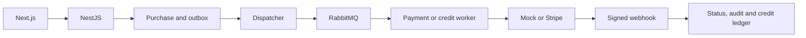

# cine-swipe: Project context and workflows

GitPageDocs **0.0.25** · 1.0.0 · 2026-11-08

## Context

Movie catalog with authentication, profiles, administration, movie purchases, a credit wallet and referrals. Movie checkout charges its monetary price; it does not debit the wallet. Credits have their own checkout and consumption. Distinguish mock and Stripe modes when interpreting approved purchases.

## Stack and architecture

TypeScript/NestJS 11 backend with Prisma 6.7/PostgreSQL, RabbitMQ, Firebase Admin and Stripe. Domain contains entities/ports; application has services; infrastructure has repositories, authentication, gateways and messaging; presentation exposes controllers/workers. Frontend: Next.js 14.2.35, React 18, Redux Toolkit and TanStack Query 5. local/firebase/hybrid modes select authentication; platform configuration selects persistence and processing.



## End-to-end workflows

1. Registration/login validates local credentials or a Firebase token and creates a session. Access/refresh cookies are HttpOnly; the CSRF cookie is readable by the client and accompanies x-csrf-token when enabled. Refresh, logout, password/profile changes and avatars have dedicated endpoints. Movie list/detail feed browsing and checkout.

2. POST /payments/checkout receives movieId and creates correlationId. In rmq mode the repository creates a PENDING Purchase and outbox; the Prisma adapter writes both transactionally. A dispatcher publishes checkout.requested; a worker invokes the gateway, updates COMPLETED/FAILED and records audit events. Timeout, attempts and DLQ are configurable. In sync mode the gateway runs within the request.

3. The /payments/webhook/stripe webhook validates the signature using the raw body and STRIPE_WEBHOOK_SECRET. Previously processed events are recognized; payment_intent.succeeded/failed update purchases. purchaseKind routes credit purchases. correlationId provides gateway idempotency; processed events and the ledger add checks. Inspect each adapter before assuming Prisma-equivalent atomicity elsewhere.

4. Credit plans → /credits/checkout → dedicated outbox/worker → approval → ledger and balance. /credits/consume debits and rejects insufficient funds. Registration can award base/referral bonuses. A referred user's first approved credit purchase can reward the referrer; configuration, correlations and reward logs prevent repeated benefits in the intended flow. Admins manage users, plans/settings and audit.

## Data, security and limitations

The Prisma schema relates User, Movie, Purchase, PaymentAudit, PaymentOutbox, CreditPlan, CreditSystemConfig, CreditTransaction, CreditPurchase, CreditPurchaseOutbox, ReferralRewardLog and ProcessedWebhookEvent. Stripe/Firebase secrets stay on the backend. Configure cookies, CORS, CSRF and uploads for the actual domain. Mock approval is not financial confirmation; verify balances/history on the backend, not only React state.

## Setup, testing and operations

Copy envexample.txt to .env and use docker compose up --build; Compose exposes frontend 3000/backend 3001 plus PostgreSQL/RabbitMQ. Run prisma:generate/migrate for the environment; migrate:deploy applies existing migrations, and review seed before using real data. Backend provides build, test and test:e2e; frontend provides build/lint. For PENDING purchases inspect outbox/broker/worker/mode; for 401/403 check cookies/CSRF; for rejected webhooks check signature/raw body. Existing payment docs detail variables/states.

## Complete reference

Dependencies, commands, endpoints, variables, contracts and tests are in the [source reference](?menu=en&lang=en&id=10).

## Verifiable sources

- [backend/src/application/payment/payment.service.ts](https://github.com/Vidigal-code/cine-swipe/blob/e169e2b03d50a8a73eaf0d9f8a1e96c4ff8ab614/backend/src/application/payment/payment.service.ts)

- [backend/src/application/credit/credit.service.ts](https://github.com/Vidigal-code/cine-swipe/blob/e169e2b03d50a8a73eaf0d9f8a1e96c4ff8ab614/backend/src/application/credit/credit.service.ts)

- [backend/src/presentation/workers/payment-outbox.dispatcher.ts](https://github.com/Vidigal-code/cine-swipe/blob/e169e2b03d50a8a73eaf0d9f8a1e96c4ff8ab614/backend/src/presentation/workers/payment-outbox.dispatcher.ts)

- [backend/src/presentation/workers/payment.worker.ts](https://github.com/Vidigal-code/cine-swipe/blob/e169e2b03d50a8a73eaf0d9f8a1e96c4ff8ab614/backend/src/presentation/workers/payment.worker.ts)

- [backend/src/shared/config/platform.config.ts](https://github.com/Vidigal-code/cine-swipe/blob/e169e2b03d50a8a73eaf0d9f8a1e96c4ff8ab614/backend/src/shared/config/platform.config.ts)

- [backend/prisma/schema.prisma](https://github.com/Vidigal-code/cine-swipe/blob/e169e2b03d50a8a73eaf0d9f8a1e96c4ff8ab614/backend/prisma/schema.prisma)

- [docker-compose.yml](https://github.com/Vidigal-code/cine-swipe/blob/e169e2b03d50a8a73eaf0d9f8a1e96c4ff8ab614/docker-compose.yml)

## Documentation navigation with GitPageDocs 0.0.25

The options in this section require the GitPageDocs **0.0.25** runtime. This project's documentation version remains **1.0.0**. Updating text and configuration does not itself update the runtime deployed by the workflow.

### Tag-based contents

In `gitpagedocs/docs/versions/1.0.0/config.json`, each `routes-md` item uses `RouteguideBrand: true` and `RouteGuideTags: ["h1", "h2", "h3"]`. The contents list includes the first three heading levels; other headings remain in the document. Property names are case-sensitive.

```json
{ "RouteguideBrand": true, "RouteGuideTags": ["h1", "h2", "h3"] }
```

Omitting `RouteGuideTags` preserves the legacy behavior, from `h1` through `h6`. An empty list (`[]`) removes automatic tag entries; explicit markers configured in `markdownMarkers.items` can still populate the contents list.

To include other elements, add tag names allowed by the sanitizer, such as `"p"`, `"blockquote"`, `"pre"`, `"table"`, `"img"`, `"details"` or `"summary"`. There is no wildcard: `"*"`, dangerous tags and invalid entries are ignored with a diagnostic. Including `p`, `li`, `div` or `span` may produce many entries; select only tags useful for reading.

Labels use a title, alternative text or element text. Empty elements such as `br`, `hr`, `img` and `input` can use the tag name. Automatic IDs are stable, unique and scoped to each block. Use `markdownMarkers.items` to select an occurrence, supply a custom label or apply a specific highlight.

### Scrolling, small screens and foldables

With contents scrolling unlocked, the active entry is centered, including navigation through Previous/Next. The lock preserves the position selected manually in the contents list. This lets readers inspect another part of the list without automatic tracking repositioning it.

When validating on a phone, check the collapsed menu, touch targets, keyboard focus, tables and horizontally scrollable code blocks. On foldable devices, repeat navigation folded and unfolded, in both orientations, and confirm the active entry remains accessible after the width changes. Use the pause control when animated effects are present and respect reduced-motion preferences.

GitPageDocs 0.0.25 uses `performance.mode: "auto"` for theme effects: it moderately reduces density on desktop and uses a smaller budget below 768px while retaining the theme's layers. Hidden particles pause and resume the same phase when the width changes. To keep full density, merge `site.backgroundEffects.overrides.performance: { "mode": "full" }` into `gitpagedocs/config.json`; the same option is available in `site.backgroundEffects.themes[themeId].performance`. An explicit `layers` override keeps the complete count when no mode is set in the overrides. Select `"auto"` explicitly to apply the budget to custom layers too.

## Fixed theme family and light/dark mode

`HideThemeSelector: true` hides the full theme picker and keeps the family selected by `ThemeDefault`. It still allows light/dark switching when that family has a valid pair. A different theme from the URL or browser storage cannot replace the fixed family.

`ThemeModeDefault` is the initial fallback. A valid mode from `modetheme=light` or `modetheme=dark` in the URL, a saved mode, or the reader’s toggle can select light/dark within that family. The selected mode survives reloads and document navigation. On narrow screens, open Menu to reach the standard control. Without a valid pair, the control is omitted.

Both entries in the layout catalog must enable `supportsLightAndDarkModes`, share the same nonempty `supportsLightAndDarkModesReference`, and declare opposite `mode` values (`light` and `dark`). This project uses the official paired catalog; keep its family and preferences when updating runtime or layout pins.

## Desktop side-guide height

On desktop screens wider than 1024 CSS pixels, the side guide ends after its last entry instead of stretching to the article height. Since 0.0.25, it can grow to the available viewport height below the header before its entries need internal scrolling. This side layout takes precedence over `TocScrollMaxHeightDesktop`; centered guides above the content and layouts at 1024 pixels and below retain their previous sizing rules. A small bar in the active entry's theme color follows the section marked while scrolling. The indicator uses the existing section tracking without continuous animation.
