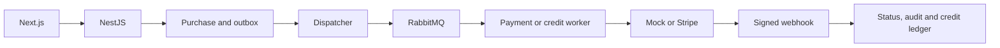

# cine-swipe

Catálogo de películas con autenticación, perfil, administración, compras, cartera de créditos y referidos. Comprar una película cobra su precio monetario; no descuenta créditos. Estos tienen checkout y consumo propios. Distinga modos mock y Stripe al interpretar compras aprobadas.

## Comportamiento implementado

Backend TypeScript/NestJS 11 con Prisma 6.7/PostgreSQL, RabbitMQ, Firebase Admin y Stripe. Domain contiene entidades/puertos; application servicios; infrastructure repositorios, autenticación, gateways y mensajería; presentation controllers/workers. Frontend Next.js 14.2.35, React 18, Redux Toolkit y TanStack Query 5. local/firebase/hybrid seleccionan autenticación; la configuración de plataforma selecciona persistencia y procesamiento.



## Flujo y casos de fallo

1. Registro/login valida credenciales locales o token Firebase y crea sesión. Cookies de acceso/refresh son HttpOnly; CSRF es legible por el cliente y acompaña x-csrf-token cuando está habilitado. Refresh, logout, contraseña/perfil y avatar tienen endpoints propios. Lista/detalle alimentan navegación y checkout.

2. POST /payments/checkout recibe movieId y crea correlationId. En rmq, el repositorio crea Purchase PENDING y outbox; Prisma guarda ambos en transacción. Dispatcher publica checkout.requested; worker llama al gateway, actualiza COMPLETED/FAILED y audita. Timeout, intentos y DLQ son configurables. En sync el gateway se ejecuta durante la petición.

3. El webhook /payments/webhook/stripe valida firma con cuerpo bruto y STRIPE_WEBHOOK_SECRET. Reconoce eventos procesados; payment_intent.succeeded/failed actualizan compras. purchaseKind dirige créditos. correlationId aporta idempotencia al gateway; eventos procesados y ledger añaden controles. No asuma atomicidad equivalente a Prisma en otros adaptadores.

4. Planes → /credits/checkout → outbox/worker propios → aprobación → ledger y saldo. /credits/consume debita y rechaza saldo insuficiente. Registro puede otorgar bonos base/referido. La primera compra aprobada del referido puede recompensar al referente; configuración, correlaciones y logs evitan repetir el beneficio previsto. Admins gestionan usuarios, planes/configuración y auditoría.

## Configuración y despliegue

Copie envexample.txt a .env y use docker compose up --build; Compose expone frontend 3000/backend 3001 más PostgreSQL/RabbitMQ. Ejecute prisma:generate/migrate según entorno; migrate:deploy aplica migrations existentes y seed requiere revisión antes de datos reales. Backend ofrece build, test/test:e2e; frontend build/lint. Ante PENDING revise outbox/broker/worker/modo; ante 401/403 cookies/CSRF; ante webhook rechazado firma/cuerpo bruto. La documentación de pagos detalla variables/estados.

## Comandos de ejecución

```sh
docker compose up --build
# Validation in a separately configured test environment
npm --prefix backend ci
npm --prefix backend run test
npm --prefix backend run build
npm --prefix frontend ci
npm --prefix frontend run build
```

## Archivos relacionados

- [backend/src/application/payment/payment.service.ts](https://github.com/Vidigal-code/cine-swipe/blob/e169e2b03d50a8a73eaf0d9f8a1e96c4ff8ab614/backend/src/application/payment/payment.service.ts)
- [backend/src/application/credit/credit.service.ts](https://github.com/Vidigal-code/cine-swipe/blob/e169e2b03d50a8a73eaf0d9f8a1e96c4ff8ab614/backend/src/application/credit/credit.service.ts)
- [backend/src/presentation/workers/payment-outbox.dispatcher.ts](https://github.com/Vidigal-code/cine-swipe/blob/e169e2b03d50a8a73eaf0d9f8a1e96c4ff8ab614/backend/src/presentation/workers/payment-outbox.dispatcher.ts)
- [backend/src/presentation/workers/payment.worker.ts](https://github.com/Vidigal-code/cine-swipe/blob/e169e2b03d50a8a73eaf0d9f8a1e96c4ff8ab614/backend/src/presentation/workers/payment.worker.ts)
- [backend/src/shared/config/platform.config.ts](https://github.com/Vidigal-code/cine-swipe/blob/e169e2b03d50a8a73eaf0d9f8a1e96c4ff8ab614/backend/src/shared/config/platform.config.ts)
- [backend/prisma/schema.prisma](https://github.com/Vidigal-code/cine-swipe/blob/e169e2b03d50a8a73eaf0d9f8a1e96c4ff8ab614/backend/prisma/schema.prisma)
- [docker-compose.yml](https://github.com/Vidigal-code/cine-swipe/blob/e169e2b03d50a8a73eaf0d9f8a1e96c4ff8ab614/docker-compose.yml)

## Navegación

- [Project guide](?menu=es&lang=es&id=9)
- [Source reference](?menu=es&lang=es&id=10)
