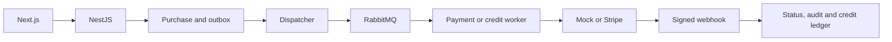

# cine-swipe: Contexto y flujos del proyecto

GitPageDocs **0.0.29** · 1.0.0 · 2026-11-23

## Contexto

Catálogo de películas con autenticación, perfil, administración, compras, cartera de créditos y referidos. Comprar una película cobra su precio monetario; no descuenta créditos. Estos tienen checkout y consumo propios. Distinga modos mock y Stripe al interpretar compras aprobadas.

## Stack y arquitectura

Backend TypeScript/NestJS 11 con Prisma 6.7/PostgreSQL, RabbitMQ, Firebase Admin y Stripe. Domain contiene entidades/puertos; application servicios; infrastructure repositorios, autenticación, gateways y mensajería; presentation controllers/workers. Frontend Next.js 14.2.35, React 18, Redux Toolkit y TanStack Query 5. local/firebase/hybrid seleccionan autenticación; la configuración de plataforma selecciona persistencia y procesamiento.



## Flujos completos

1. Registro/login valida credenciales locales o token Firebase y crea sesión. Cookies de acceso/refresh son HttpOnly; CSRF es legible por el cliente y acompaña x-csrf-token cuando está habilitado. Refresh, logout, contraseña/perfil y avatar tienen endpoints propios. Lista/detalle alimentan navegación y checkout.

2. POST /payments/checkout recibe movieId y crea correlationId. En rmq, el repositorio crea Purchase PENDING y outbox; Prisma guarda ambos en transacción. Dispatcher publica checkout.requested; worker llama al gateway, actualiza COMPLETED/FAILED y audita. Timeout, intentos y DLQ son configurables. En sync el gateway se ejecuta durante la petición.

3. El webhook /payments/webhook/stripe valida firma con cuerpo bruto y STRIPE_WEBHOOK_SECRET. Reconoce eventos procesados; payment_intent.succeeded/failed actualizan compras. purchaseKind dirige créditos. correlationId aporta idempotencia al gateway; eventos procesados y ledger añaden controles. No asuma atomicidad equivalente a Prisma en otros adaptadores.

4. Planes → /credits/checkout → outbox/worker propios → aprobación → ledger y saldo. /credits/consume debita y rechaza saldo insuficiente. Registro puede otorgar bonos base/referido. La primera compra aprobada del referido puede recompensar al referente; configuración, correlaciones y logs evitan repetir el beneficio previsto. Admins gestionan usuarios, planes/configuración y auditoría.

## Datos, seguridad y límites

Prisma relaciona User, Movie, Purchase, PaymentAudit, PaymentOutbox, CreditPlan, CreditSystemConfig, CreditTransaction, CreditPurchase, CreditPurchaseOutbox, ReferralRewardLog y ProcessedWebhookEvent. Secretos Stripe/Firebase quedan en backend. Configure cookies, CORS, CSRF y uploads para el dominio real. Una aprobación mock no confirma dinero; verifique saldo/historial en backend.

## Ejecución, pruebas y operación

Copie envexample.txt a .env y use docker compose up --build; Compose expone frontend 3000/backend 3001 más PostgreSQL/RabbitMQ. Ejecute prisma:generate/migrate según entorno; migrate:deploy aplica migrations existentes y seed requiere revisión antes de datos reales. Backend ofrece build, test/test:e2e; frontend build/lint. Ante PENDING revise outbox/broker/worker/modo; ante 401/403 cookies/CSRF; ante webhook rechazado firma/cuerpo bruto. La documentación de pagos detalla variables/estados.

## Referencia completa

Dependencias, comandos, endpoints, variables, contratos y pruebas están en la [referencia del código](?menu=es&lang=es&id=10).

## Fuentes verificables

- [backend/src/application/payment/payment.service.ts](https://github.com/Vidigal-code/cine-swipe/blob/e169e2b03d50a8a73eaf0d9f8a1e96c4ff8ab614/backend/src/application/payment/payment.service.ts)

- [backend/src/application/credit/credit.service.ts](https://github.com/Vidigal-code/cine-swipe/blob/e169e2b03d50a8a73eaf0d9f8a1e96c4ff8ab614/backend/src/application/credit/credit.service.ts)

- [backend/src/presentation/workers/payment-outbox.dispatcher.ts](https://github.com/Vidigal-code/cine-swipe/blob/e169e2b03d50a8a73eaf0d9f8a1e96c4ff8ab614/backend/src/presentation/workers/payment-outbox.dispatcher.ts)

- [backend/src/presentation/workers/payment.worker.ts](https://github.com/Vidigal-code/cine-swipe/blob/e169e2b03d50a8a73eaf0d9f8a1e96c4ff8ab614/backend/src/presentation/workers/payment.worker.ts)

- [backend/src/shared/config/platform.config.ts](https://github.com/Vidigal-code/cine-swipe/blob/e169e2b03d50a8a73eaf0d9f8a1e96c4ff8ab614/backend/src/shared/config/platform.config.ts)

- [backend/prisma/schema.prisma](https://github.com/Vidigal-code/cine-swipe/blob/e169e2b03d50a8a73eaf0d9f8a1e96c4ff8ab614/backend/prisma/schema.prisma)

- [docker-compose.yml](https://github.com/Vidigal-code/cine-swipe/blob/e169e2b03d50a8a73eaf0d9f8a1e96c4ff8ab614/docker-compose.yml)

## Navegación de la documentación con GitPageDocs 0.0.29

Esta guía describe el runtime GitPageDocs **0.0.29**. La versión documental de este proyecto sigue siendo **1.0.0**. Actualizar texto y configuración no actualiza por sí solo el runtime publicado por el workflow.

### Índice por etiquetas

En `gitpagedocs/docs/versions/1.0.0/config.json`, cada elemento de `routes-md` utiliza `RouteguideBrand: true` y `RouteGuideTags: ["h1", "h2", "h3"]`. El índice incluye los tres primeros niveles de encabezados; los demás permanecen en el documento. Los nombres de propiedades distinguen mayúsculas y minúsculas.

```json
{ "RouteguideBrand": true, "RouteGuideTags": ["h1", "h2", "h3"] }
```

Omitir `RouteGuideTags` conserva el comportamiento anterior, de `h1` a `h6`. Una lista vacía (`[]`) elimina las entradas automáticas por etiqueta; los marcadores explícitos configurados en `markdownMarkers.items` todavía pueden formar parte del índice.

Para incluir otros elementos, añada nombres de etiquetas permitidas por el sanitizador, como `"p"`, `"blockquote"`, `"pre"`, `"table"`, `"img"`, `"details"` o `"summary"`. No hay comodines: `"*"`, las etiquetas peligrosas y las entradas inválidas se ignoran con un diagnóstico. Incluir `p`, `li`, `div` o `span` puede generar muchas entradas; seleccione solo las etiquetas útiles para la lectura.

Los rótulos usan título, texto alternativo o texto del elemento. Los elementos vacíos como `br`, `hr`, `img` e `input` pueden usar el nombre de la etiqueta. Los IDs automáticos son estables, únicos y separados por bloque. Utilice `markdownMarkers.items` para elegir una ocurrencia, definir un rótulo propio o aplicar un resaltado específico.

### Desplazamiento, pantallas pequeñas y plegables

Con el desplazamiento del índice desbloqueado, la entrada activa queda centrada, incluso al navegar con Anterior/Siguiente. El candado conserva la posición elegida manualmente en el índice. Esto permite consultar otra parte del índice sin que el seguimiento automático desplace la lista.

Al validar en un móvil, revise el menú contraído, las áreas táctiles, el foco del teclado, las tablas y los bloques de código con desplazamiento horizontal. En dispositivos plegables, repita la navegación con la pantalla plegada y abierta, en ambas orientaciones, y compruebe que la entrada activa siga accesible tras cambiar el ancho. Utilice el control de pausa cuando haya efectos animados y respete la preferencia de movimiento reducido.

GitPageDocs 0.0.26 utiliza `performance.mode: "auto"` para los efectos de los temas: reduce moderadamente la densidad en escritorio y utiliza un presupuesto menor por debajo de 768px, conservando las capas del tema. Las partículas ocultas se pausan y retoman la misma fase al cambiar el ancho. Para mantener la densidad completa, combine `site.backgroundEffects.overrides.performance: { "mode": "full" }` con `gitpagedocs/config.json`; la misma opción está disponible en `site.backgroundEffects.themes[themeId].performance`. Un override explícito de `layers` conserva la cantidad completa cuando no se define mode en los overrides. Seleccione `"auto"` explícitamente para aplicar el presupuesto también a las capas personalizadas.

## Familia de tema fija y modo claro/oscuro

`HideThemeSelector: true` oculta el selector completo de temas y mantiene la familia elegida por `ThemeDefault`. La alternancia claro/oscuro sigue disponible cuando esa familia tiene un par válido. Un tema diferente procedente de la URL o del almacenamiento del navegador no sustituye la familia fija.

`ThemeModeDefault` es el valor inicial de respaldo. Un modo válido en `modetheme=light` o `modetheme=dark` de la URL, un modo guardado o el botón del lector puede seleccionar claro/oscuro dentro de esa familia. El modo elegido se conserva al recargar y navegar entre documentos. En pantallas estrechas, abra Menu para acceder al control estándar. Sin un par válido, el control no aparece.

Las dos entradas del catálogo de layouts deben habilitar `supportsLightAndDarkModes`, compartir el mismo `supportsLightAndDarkModesReference` no vacío y declarar valores opuestos de `mode` (`light` y `dark`). Este proyecto utiliza el catálogo oficial con pares; conserve su familia y preferencias al actualizar los pins del runtime o de los layouts.

## Altura de la guía lateral de escritorio

En pantallas de escritorio con más de 1024 píxeles CSS, la guía lateral termina después de su última entrada, sin extenderse hasta el final del artículo. Desde 0.0.25, puede crecer hasta la altura disponible de la ventana debajo de la cabecera antes de necesitar desplazamiento interno. Este diseño lateral tiene prioridad sobre `TocScrollMaxHeightDesktop`; la guía centrada encima del contenido y los diseños de hasta 1024 píxeles mantienen sus reglas de tamaño anteriores. Una pequeña barra con el color de la entrada activa sigue la sección marcada al desplazarse. El indicador utiliza el seguimiento de secciones existente, sin animación continua. En GitPageDocs 0.0.26, las guías laterales ganan 0.5rem adicionales de espacio debajo de la cabecera (8px con la fuente raíz predeterminada) y conservan 1rem debajo de la tarjeta en el límite de la ventana. Este ajuste se aplica solo por encima de 1024 píxeles CSS; los diseños menores se mantienen.

## Desplazamiento de la guía y del código fuente

Desde GitPageDocs 0.0.27, el visor Source code limita su área de contenido a la altura disponible de la ventana. Cuando esa pantalla está disponible, las listas largas y las vistas previas se desplazan dentro del contenedor. El workflow de este proyecto mantiene la redirección de la página independiente `source-viewer` a la documentación.

Desde la 0.0.28, la guía mantiene 1.5rem entre las entradas y la barra de desplazamiento (24 píxeles CSS con la fuente raíz predeterminada). En Chromium/WebKit, la barra mide 4px, con pista transparente e indicador translúcido del color del tema. Los navegadores que no aplican este estilo utilizan barras finas nativas cuando son compatibles.

## Controles dentro de Markdown

En la 0.0.29, Anterior, Siguiente y Volver arriba están dentro de la tarjeta Markdown, después del contenido, con 8px de espacio en el flujo normal para no cubrir texto, tablas ni imágenes. `site.documentNavigation.position` sigue aceptando `"left"`, `"center"` y `"right"`; este proyecto conserva `"center"`.

Los botones de icono siguen el estilo compacto de copiar y descargar: 36px en escritorio, con una altura táctil mínima de 44px en dispositivos de puntero impreciso, como teléfonos. Se conservan las etiquetas e iconos configurados, el foco por teclado y los límites deshabilitados de navegación. Volver arriba sigue respetando `site.backToTop.enabled` y `minPageHeightViewports`.

El modo foco utiliza el ojo enmarcado `LuScanEye` en `site.icons.FocusMode.tag`. Este botón abre la lectura en foco; copiar, descargar, navegar y cerrar mantienen sus funciones. Las personalizaciones de color, tamaño, imagen y texto siguen disponibles.
