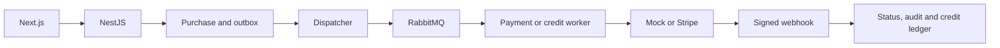

# cine-swipe: Contexto e fluxos do projeto

GitPageDocs **0.0.29** · 1.0.0 · 2026-11-23

## Contexto

Catálogo de filmes com autenticação, perfil, administração, compra de filmes, carteira de créditos e indicações. Compra de filme cobra seu preço em dinheiro; não desconta a carteira. Créditos têm checkout e consumo próprios. Os modos mock e Stripe precisam ser distinguidos ao interpretar uma compra aprovada.

## Stack e arquitetura

Backend TypeScript/NestJS 11 com Prisma 6.7/PostgreSQL, RabbitMQ, Firebase Admin e Stripe. Domain contém entidades/portas; application contém serviços; infrastructure contém repositórios, autenticação, gateways e mensageria; presentation expõe controllers/workers. Frontend Next.js 14.2.35, React 18, Redux Toolkit e TanStack Query 5. Modos local/firebase/hybrid selecionam autenticação; a configuração de plataforma seleciona persistência e processamento.



## Fluxos completos

1. Cadastro/login valida credenciais locais ou token Firebase e cria sessão. Cookies de acesso/refresh são HttpOnly; o cookie CSRF é legível pelo cliente e acompanha x-csrf-token conforme configuração. Refresh, logout, alteração de senha/perfil e avatar possuem endpoints próprios. A lista e o detalhe de filmes alimentam a navegação e o checkout.

2. POST /payments/checkout recebe movieId e gera correlationId. No modo rmq, o repositório cria Purchase PENDING e outbox; no adaptador Prisma, ambos são gravados em transação. Dispatcher publica checkout.requested; worker chama o gateway, atualiza COMPLETED/FAILED e registra auditoria. Timeout, tentativas e DLQ são configuráveis. No modo sync, o gateway é chamado dentro da requisição.

3. Webhook /payments/webhook/stripe valida assinatura usando o corpo bruto e STRIPE_WEBHOOK_SECRET. Eventos já processados são reconhecidos; payment_intent.succeeded/failed atualizam compras. purchaseKind direciona créditos. correlationId fornece chave de idempotência ao gateway; evento processado e ledger possuem controles adicionais. Inspecione cada adaptador antes de assumir a mesma atomicidade fora do Prisma.

4. Planos de créditos → /credits/checkout → outbox/worker próprios → aprovação → ledger e saldo. /credits/consume aplica débito e rejeita saldo insuficiente. Cadastro pode conceder bônus base e bônus por indicação. A primeira compra de créditos aprovada do indicado pode recompensar o indicador; configuração, correlações e logs de recompensa evitam repetir o benefício no fluxo previsto. Admins gerenciam usuários, planos/configuração e auditoria.

## Dados, segurança e limites

O esquema Prisma relaciona User, Movie, Purchase, PaymentAudit, PaymentOutbox, CreditPlan, CreditSystemConfig, CreditTransaction, CreditPurchase, CreditPurchaseOutbox, ReferralRewardLog e ProcessedWebhookEvent. Segredos Stripe/Firebase permanecem no backend. Configure cookies, CORS, CSRF e uploads segundo o domínio efetivo. Mock aprovado não é confirmação financeira; saldo e histórico devem ser verificados no backend, não apenas no estado React.

## Execução, testes e operação

Copie envexample.txt para .env e use docker compose up --build; Compose publica frontend 3000 e backend 3001, além de PostgreSQL e RabbitMQ. Execute prisma:generate/migrate conforme o ambiente; migrate:deploy aplica migrations existentes, e seed deve ser revisado antes de uso em dados reais. Backend oferece build, test e test:e2e; frontend oferece build/lint. Para compras PENDING, confira outbox, broker, worker e modo; para 401/403, cookies/CSRF; para webhook rejeitado, assinatura/corpo bruto. A documentação existente de pagamentos detalha variáveis e estados.

## Referência completa

Dependências, comandos, endpoints, variáveis, contratos e testes estão na [referência do código](?menu=pt&lang=pt&id=10).

## Fontes verificáveis

- [backend/src/application/payment/payment.service.ts](https://github.com/Vidigal-code/cine-swipe/blob/e169e2b03d50a8a73eaf0d9f8a1e96c4ff8ab614/backend/src/application/payment/payment.service.ts)

- [backend/src/application/credit/credit.service.ts](https://github.com/Vidigal-code/cine-swipe/blob/e169e2b03d50a8a73eaf0d9f8a1e96c4ff8ab614/backend/src/application/credit/credit.service.ts)

- [backend/src/presentation/workers/payment-outbox.dispatcher.ts](https://github.com/Vidigal-code/cine-swipe/blob/e169e2b03d50a8a73eaf0d9f8a1e96c4ff8ab614/backend/src/presentation/workers/payment-outbox.dispatcher.ts)

- [backend/src/presentation/workers/payment.worker.ts](https://github.com/Vidigal-code/cine-swipe/blob/e169e2b03d50a8a73eaf0d9f8a1e96c4ff8ab614/backend/src/presentation/workers/payment.worker.ts)

- [backend/src/shared/config/platform.config.ts](https://github.com/Vidigal-code/cine-swipe/blob/e169e2b03d50a8a73eaf0d9f8a1e96c4ff8ab614/backend/src/shared/config/platform.config.ts)

- [backend/prisma/schema.prisma](https://github.com/Vidigal-code/cine-swipe/blob/e169e2b03d50a8a73eaf0d9f8a1e96c4ff8ab614/backend/prisma/schema.prisma)

- [docker-compose.yml](https://github.com/Vidigal-code/cine-swipe/blob/e169e2b03d50a8a73eaf0d9f8a1e96c4ff8ab614/docker-compose.yml)

## Navegação da documentação com GitPageDocs 0.0.29

Este guia descreve o runtime GitPageDocs **0.0.29**. A versão documental deste projeto continua **1.0.0**. Atualizar o texto e a configuração não atualiza, por si só, o runtime publicado pelo workflow.

### Índice por tags

Em `gitpagedocs/docs/versions/1.0.0/config.json`, cada item de `routes-md` usa `RouteguideBrand: true` e `RouteGuideTags: ["h1", "h2", "h3"]`. O índice mantém os três primeiros níveis de títulos; os demais títulos continuam no documento. A grafia das propriedades diferencia maiúsculas e minúsculas.

```json
{ "RouteguideBrand": true, "RouteGuideTags": ["h1", "h2", "h3"] }
```

Omitir `RouteGuideTags` preserva o comportamento legado, com `h1` até `h6`. Uma lista vazia (`[]`) remove as entradas automáticas por tag; marcadores explícitos configurados em `markdownMarkers.items` ainda podem compor o índice.

Para incluir outros elementos, acrescente nomes de tags permitidas pelo sanitizador, por exemplo `"p"`, `"blockquote"`, `"pre"`, `"table"`, `"img"`, `"details"` ou `"summary"`. Não existe curinga: `"*"`, tags perigosas e entradas inválidas são ignorados com diagnóstico. Incluir `p`, `li`, `div` ou `span` pode gerar muitas entradas; prefira somente as tags úteis para a leitura.

Os rótulos usam título, texto alternativo ou texto do elemento. Elementos vazios como `br`, `hr`, `img` e `input` podem usar o nome da tag. IDs automáticos são estáveis, únicos e separados por bloco. Use `markdownMarkers.items` quando precisar escolher uma ocorrência, definir rótulo próprio ou aplicar um destaque específico.

### Rolagem, telas pequenas e dobráveis

Com a rolagem do índice desbloqueada, o item ativo é centralizado, inclusive ao navegar por Anterior/Próximo. O cadeado preserva a posição escolhida manualmente no índice. Isso permite consultar outra parte do índice sem que o acompanhamento automático reposicione a lista.

Ao validar em celular, confira o menu recolhido, alvos de toque, foco por teclado, tabelas e blocos de código com rolagem horizontal. Em dispositivos dobráveis, repita a navegação com a tela dobrada e aberta, nas duas orientações, e confirme que o item ativo permanece acessível após a mudança de largura. Use o controle de pausa quando houver efeitos animados e respeite a preferência de movimento reduzido.

O GitPageDocs 0.0.26 usa `performance.mode: "auto"` nos efeitos dos temas: reduz moderadamente a densidade no desktop e usa um orçamento menor abaixo de 768px, mantendo as camadas do tema. Partículas ocultas ficam pausadas e retomam a mesma fase ao mudar a largura. Para manter a densidade completa, mescle `site.backgroundEffects.overrides.performance: { "mode": "full" }` em `gitpagedocs/config.json`; a mesma opção pode ser definida em `site.backgroundEffects.themes[themeId].performance`. Um override explícito de `layers` mantém a contagem completa quando não há mode definido nos overrides. Use `"auto"` explicitamente para aplicar o orçamento também às camadas personalizadas.

## Família de tema fixa e modo claro/escuro

`HideThemeSelector: true` oculta o seletor completo de temas e mantém a família escolhida por `ThemeDefault`. A alternância claro/escuro continua disponível quando essa família possui um par válido. Um tema diferente vindo da URL ou do armazenamento do navegador não substitui a família fixa.

`ThemeModeDefault` é o fallback inicial. Um modo válido em `modetheme=light` ou `modetheme=dark` na URL, um modo salvo ou o botão do leitor pode selecionar claro/escuro dentro dessa família. O modo escolhido permanece após recarregar e navegar entre documentos. Em telas estreitas, abra Menu para acessar o controle padrão. Sem um par válido, o controle não aparece.

As duas entradas do catálogo de layouts devem habilitar `supportsLightAndDarkModes`, compartilhar o mesmo `supportsLightAndDarkModesReference` não vazio e declarar valores opostos de `mode` (`light` e `dark`). Este projeto usa o catálogo oficial com pares; preserve sua família e preferências ao atualizar os pins do runtime ou dos layouts.

## Altura do guia lateral desktop

Em telas desktop com mais de 1024 pixels CSS, o guia lateral termina após o último item, sem se estender até o fim do artigo. Desde a 0.0.25, ele pode crescer até a altura disponível da janela abaixo do cabeçalho antes de precisar de rolagem interna. Esse layout lateral tem prioridade sobre `TocScrollMaxHeightDesktop`; o guia centralizado acima do conteúdo e os layouts de até 1024 pixels mantêm suas regras anteriores de dimensionamento. Uma pequena barra na cor do item ativo acompanha a seção marcada durante a rolagem. O indicador usa o acompanhamento de seções existente, sem animação contínua. No GitPageDocs 0.0.26, os guias laterais ganham mais 0.5rem de espaço abaixo do cabeçalho (8px com a fonte raiz padrão) e mantêm 1rem abaixo do cartão no limite da viewport. Esse ajuste vale somente acima de 1024 pixels CSS; os layouts menores são preservados.

## Rolagem do guia e do código-fonte

Desde o GitPageDocs 0.0.27, o visualizador Source code limita sua área de conteúdo à altura disponível da janela. Quando essa tela está disponível, listas longas e prévias rolam dentro do contêiner. O workflow deste projeto mantém o redirecionamento da página independente `source-viewer` para a documentação.

Desde a 0.0.28, o guia mantém 1.5rem entre as entradas e a barra de rolagem (24 pixels CSS com a fonte raiz padrão). Em Chromium/WebKit, a barra tem 4px, trilha transparente e indicador translúcido na cor do tema. Navegadores que não aplicam esse estilo usam a barra fina nativa quando suportada.

## Controles dentro do Markdown

Na 0.0.29, Anterior, Próximo e Subir ao topo ficam dentro do cartão Markdown, após o conteúdo, com 8px de espaço no fluxo normal para não cobrir textos, tabelas ou imagens. `site.documentNavigation.position` continua aceitando `"left"`, `"center"` e `"right"`; este projeto mantém `"center"`.

Os botões de ícone seguem o padrão compacto de copiar e baixar: 36px no desktop, com altura mínima de toque de 44px em dispositivos de ponteiro impreciso, como celulares. Rótulos e ícones configurados, foco por teclado e limites desabilitados de navegação são preservados. Subir ao topo continua respeitando `site.backToTop.enabled` e `minPageHeightViewports`.

O modo foco usa o olho enquadrado `LuScanEye` em `site.icons.FocusMode.tag`. Esse botão abre a leitura em foco; copiar, baixar, navegar e fechar mantêm suas funções. Personalizações de cor, tamanho, imagem e texto continuam disponíveis.
