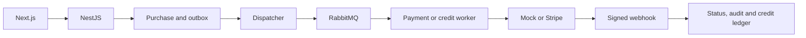

# cine-swipe: Contexto e fluxos do projeto

GitPageDocs **0.0.17** · 1.0.0 · 2026-10-29

## Contexto

Catálogo de filmes com autenticação, perfil, administração, compra de filmes, carteira de créditos e indicações. Compra de filme cobra seu preço em dinheiro; não desconta a carteira. Créditos têm checkout e consumo próprios. Os modos mock e Stripe precisam ser distinguidos ao interpretar uma compra aprovada.

## Stack e arquitetura

Backend TypeScript/NestJS 11 com Prisma 6.7/PostgreSQL, RabbitMQ, Firebase Admin e Stripe. Domain contém entidades/portas; application contém serviços; infrastructure contém repositórios, autenticação, gateways e mensageria; presentation expõe controllers/workers. Frontend Next.js 14.2.35, React 18, Redux Toolkit e TanStack Query 5. Modos local/firebase/hybrid selecionam autenticação; a configuração de plataforma seleciona persistência e processamento.

## Fluxos completos

1. Cadastro/login valida credenciais locais ou token Firebase e cria sessão. Cookies de acesso/refresh são HttpOnly; o cookie CSRF é legível pelo cliente e acompanha x-csrf-token conforme configuração. Refresh, logout, alteração de senha/perfil e avatar possuem endpoints próprios. A lista e o detalhe de filmes alimentam a navegação e o checkout.

2. POST /payments/checkout recebe movieId e gera correlationId. No modo rmq, o repositório cria Purchase PENDING e outbox; no adaptador Prisma, ambos são gravados em transação. Dispatcher publica checkout.requested; worker chama o gateway, atualiza COMPLETED/FAILED e registra auditoria. Timeout, tentativas e DLQ são configuráveis. No modo sync, o gateway é chamado dentro da requisição.

3. Webhook /payments/webhook/stripe valida assinatura usando o corpo bruto e STRIPE_WEBHOOK_SECRET. Eventos já processados são reconhecidos; payment_intent.succeeded/failed atualizam compras. purchaseKind direciona créditos. correlationId fornece chave de idempotência ao gateway; evento processado e ledger possuem controles adicionais. Inspecione cada adaptador antes de assumir a mesma atomicidade fora do Prisma.

4. Planos de créditos → /credits/checkout → outbox/worker próprios → aprovação → ledger e saldo. /credits/consume aplica débito e rejeita saldo insuficiente. Cadastro pode conceder bônus base e bônus por indicação. A primeira compra de créditos aprovada do indicado pode recompensar o indicador; configuração, correlações e logs de recompensa evitam repetir o benefício no fluxo previsto. Admins gerenciam usuários, planos/configuração e auditoria.

## Dados, segurança e limites

O esquema Prisma relaciona User, Movie, Purchase, PaymentAudit, PaymentOutbox, CreditPlan, CreditSystemConfig, CreditTransaction, CreditPurchase, CreditPurchaseOutbox, ReferralRewardLog e ProcessedWebhookEvent. Segredos Stripe/Firebase permanecem no backend. Configure cookies, CORS, CSRF e uploads segundo o domínio efetivo. Mock aprovado não é confirmação financeira; saldo e histórico devem ser verificados no backend, não apenas no estado React.

## Execução, testes e operação

Copie envexample.txt para .env e use docker compose up --build; Compose publica frontend 3000 e backend 3001, além de PostgreSQL e RabbitMQ. Execute prisma:generate/migrate conforme o ambiente; migrate:deploy aplica migrations existentes, e seed deve ser revisado antes de uso em dados reais. Backend oferece build, test e test:e2e; frontend oferece build/lint. Para compras PENDING, confira outbox, broker, worker e modo; para 401/403, cookies/CSRF; para webhook rejeitado, assinatura/corpo bruto. A documentação existente de pagamentos detalha variáveis e estados.

## Referência completa

Dependências, comandos, endpoints, variáveis, contratos e testes estão na [referência do código](?menu=pt&lang=pt&id=10).

## Fontes verificáveis

- [backend/src/application/payment/payment.service.ts](https://github.com/Vidigal-code/cine-swipe/blob/e169e2b03d50a8a73eaf0d9f8a1e96c4ff8ab614/backend/src/application/payment/payment.service.ts)

- [backend/src/application/credit/credit.service.ts](https://github.com/Vidigal-code/cine-swipe/blob/e169e2b03d50a8a73eaf0d9f8a1e96c4ff8ab614/backend/src/application/credit/credit.service.ts)

- [backend/src/presentation/workers/payment-outbox.dispatcher.ts](https://github.com/Vidigal-code/cine-swipe/blob/e169e2b03d50a8a73eaf0d9f8a1e96c4ff8ab614/backend/src/presentation/workers/payment-outbox.dispatcher.ts)

- [backend/src/presentation/workers/payment.worker.ts](https://github.com/Vidigal-code/cine-swipe/blob/e169e2b03d50a8a73eaf0d9f8a1e96c4ff8ab614/backend/src/presentation/workers/payment.worker.ts)

- [backend/src/shared/config/platform.config.ts](https://github.com/Vidigal-code/cine-swipe/blob/e169e2b03d50a8a73eaf0d9f8a1e96c4ff8ab614/backend/src/shared/config/platform.config.ts)

- [backend/prisma/schema.prisma](https://github.com/Vidigal-code/cine-swipe/blob/e169e2b03d50a8a73eaf0d9f8a1e96c4ff8ab614/backend/prisma/schema.prisma)

- [docker-compose.yml](https://github.com/Vidigal-code/cine-swipe/blob/e169e2b03d50a8a73eaf0d9f8a1e96c4ff8ab614/docker-compose.yml)
